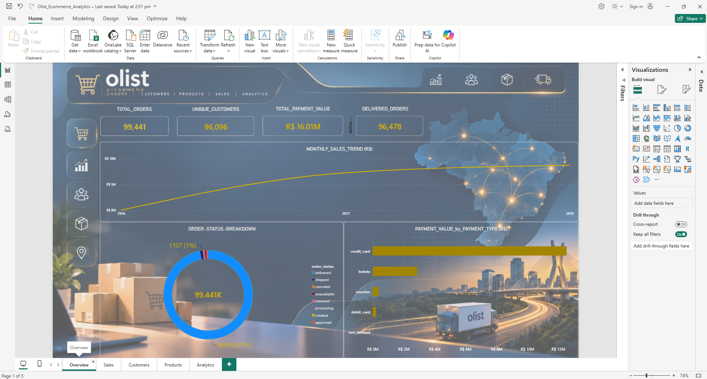
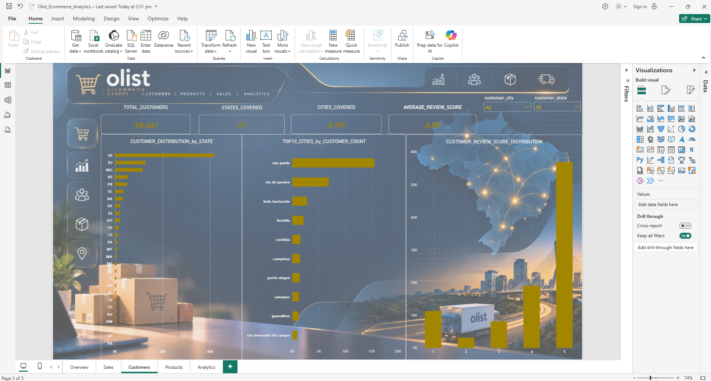
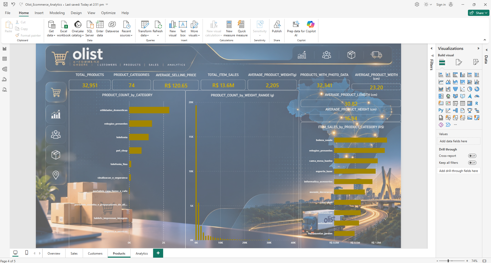
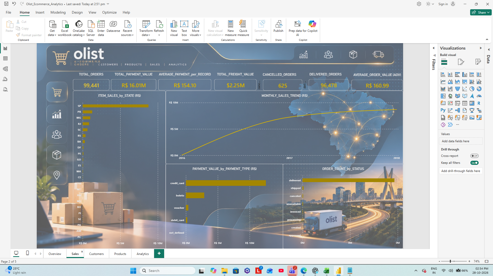
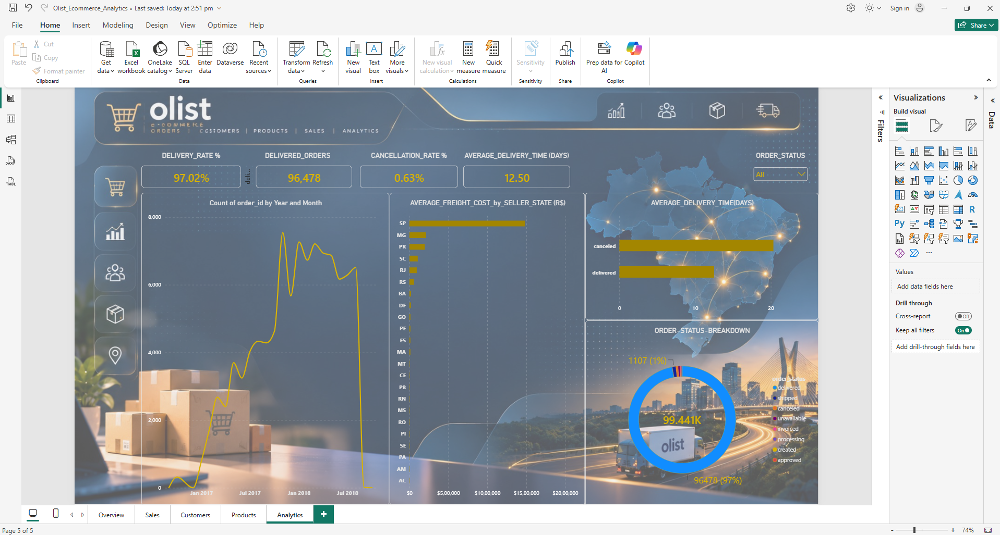

# **🛒 Olist E-Commerce Analytics Dashboard**

## **Project Overview**

This project analyzes Brazilian e-commerce data from Olist to understand order performance, customer behavior, product performance, sales trends, and delivery operations.

The solution was developed using Microsoft Power BI to transform raw datasets into an interactive business intelligence dashboard. The project covers data preparation, data modeling, DAX calculations, KPI development, and visual analytics to support data-driven decision-making.

##### **📑 Table of Contents**

* ###### **Project Overview**
* ###### **Project Objective**
* ###### **Skills Demonstrated**
* ###### **Tools and Technologies**
* ###### **Dataset Overview**
* ###### **Dashboard Pages and Features**
* ###### **Key Performance Indicators**
* ###### **Data Preparation and Modeling**
* ###### **Data Visualization**
* ###### **Business Value**
* ###### **Dashboard Screenshots**
* ###### **Data Model**
* ###### **Key Business Takeaways**
* ###### **Project Limitations**
* ###### **Repository Structure**
* ###### **Conclusion**

#### **🎯 Project Objective**

The objective of this project is to transform raw e-commerce transaction data into actionable business insights using Microsoft Power BI.

The dashboard enables analysis of sales performance, customer behavior, product trends, payment methods, order fulfillment, and delivery efficiency to support data-driven decision-making.

###### **💡 Skills Demonstrated**

Data Cleaning and Transformation

Power Query

Data Modeling

DAX Measures and KPI Development

Business Intelligence Reporting

Dashboard Design

Exploratory Data Analysis (EDA)

Data Visualization

Performance Monitoring

Interactive Dashboard Development

###### 

###### **🛠️ Tools and Technologies**

Microsoft Power BI Desktop – Dashboard development and data visualization

Power Query – Data cleaning, transformation, and preparation

DAX (Data Analysis Expressions) – KPI calculations and analytical measures

Data Modeling – Establishing relationships between datasets for accurate analysis

###### **📊 Dataset Overview**

The project uses the Olist Brazilian E-Commerce Dataset, which contains information about orders, customers, products, sellers, payments, reviews, and geographic locations.

Source Datasets

Orders

Order Items

Customers

Products

Sellers

Payments

Reviews

Geolocation

Product Category Name Translation

These datasets are used to analyze customer behavior, sales performance, product categories, payment methods, order fulfillment, and delivery operations.

###### **📈 Dashboard Pages and Features**

**1. Overview Dashboard**

Displays key performance indicators including total orders, unique customers, total payment value, and delivered orders.

Analyzes monthly sales trends.

Shows the distribution of order statuses.

Compares payment value across payment methods.

**2. Customers Dashboard**

Analyzes customer distribution across states and cities.

Displays customer review score distribution.

Highlights the top 10 cities by customer count.

Includes state and city slicers for interactive filtering.

**3. Products Dashboard**

Analyzes product counts and product categories.

Displays product photo coverage and product dimension metrics.

Examines product weight distribution.

Identifies top product categories by item sales value.

**4. Sales Dashboard**

Tracks payment value, order volume, and average order value.

Analyzes monthly sales performance.

Compares payment value by payment type.

Examines order status and item sales value by seller state.

**5. Analytics Dashboard**

Monitors delivery rate and cancellation rate.

Analyzes average delivery time.

Tracks monthly order trends.

Compares average freight cost across seller states.

Includes interactive order status filtering.

###### **📌 Key Performance Indicators**

**KPI	                       Value**

Total Orders	               99,441

Unique Customers	           96,096

Delivered Orders	           96,478

Total Payment Value	         Approximately R$16.01 Million

Average Order Value	         Approximately R$160.99

Delivery Rate	               97.02%

Cancellation Rate            0.63%

Average Delivery Time	       12.50 Days

Total Products	             32,951

Products with Photos         32,341

Average Review Score	       4.09 / 5

These metrics help evaluate order fulfillment, customer activity, payment performance, product coverage, customer satisfaction, and delivery efficiency.

**Note**: Payment value represents recorded customer payments in the dataset and should not automatically be interpreted as revenue, profit, or business earnings.

###### **🔄 Data Preparation and Modeling**

**Data Preparation**

Imported the Olist source datasets into Power BI.

Used Power Query to prepare and transform the data.

Reviewed and corrected column data types.

Created delivery duration calculations using order purchase and delivery dates.

**Data Modeling**

Established relationships between Orders, Order Items, Customers, Products, Sellers, Payments, Reviews, and Product Category Translation tables.

Used order identifiers and relevant business keys to connect related datasets.

Kept the Geolocation dataset separate because it was not required in the dashboard model.

**DAX and Business Metrics**

Created measures for:

Total Orders

Unique Customers

Total Payment Value

Average Order Value

Delivered Orders

Delivery Rate

Cancellation Rate

Average Delivery Time

Additional modeling techniques included:

Distinct count calculations to avoid duplicate records.

Date-based analysis for monthly trends.

Interactive filters and slicers.

KPI performance calculations.

###### **📊 Data Visualization**

The dashboard includes:

KPI Cards

Bar Charts

Line Charts

Donut Charts

Interactive Slicers

Navigation Buttons

Cross-filtering Visuals

Consistent formatting and design principles were applied across all dashboard pages to improve usability and readability.

###### **🚀 Business Value**

The dashboard helps stakeholders:

Monitor sales and order performance.

Track customer activity and geographic distribution.

Identify top-performing product categories.

Evaluate customer satisfaction through review analysis.

Measure delivery efficiency and cancellation trends.

Compare payment method usage and purchasing patterns.

Support operational and strategic business decision-making.

###### **📷 Dashboard Screenshots**

### 1. Overview Dashboard

  `

### 2. Customers Dashboard

  '

### 3. Products Dashboard

  '

### 4. Sales Dashboard

  '

### 5. Analytics Dashboard

  '

###### **🗂️ Data Model**

**Data Model**

The data model demonstrates relationship design and dimensional modeling skills, which are critical components of Power BI development.

###### **🔍 Key Business Takeaways**

The dashboard provides a comprehensive overview of order volume, customer activity, and payment trends.

Order status analysis helps assess fulfillment performance and cancellation patterns.

Geographic analysis highlights customer concentration across different states and cities.

Product analysis identifies high-performing categories and product characteristics.

Delivery metrics reveal operational efficiency through delivery duration and freight cost patterns.

Interactive filters allow users to explore data from multiple business perspectives.

###### **⚠️ Project Limitations**

The analysis is based on historical Olist e-commerce data rather than live transaction data.

Metrics depend on the definitions, assumptions, and calculations implemented in the Power BI model.

Payment value should not be interpreted as profit because operational costs and business expenses are not included.

The dashboard focuses on descriptive analytics and does not independently determine the causes of business outcomes.

###### **📁 Repository Structure**

Olist-Ecommerce-Analytics-Dashboard/

│

├── Dataset/

├── PowerBI_File/

├── Documentation/

├── 04\_SCREENSHOTS/

│   ├── overview\_dashboard.png

│   ├── customers\_dashboard.png

│   ├── products\_dashboard.png

│   ├── sales\_dashboard.png

│   ├── analytics\_dashboard.png

│   └── data\_model.png

│

└── README.md

###### **✅ Conclusion**

This project demonstrates the end-to-end development of a business intelligence solution using Microsoft Power BI. By integrating multiple datasets, creating a structured data model, developing DAX measures, and designing interactive dashboards, the project delivers valuable insights into sales performance, customer behavior, product trends, and delivery operations.

The dashboard provides a scalable foundation for analyzing e-commerce performance and supports informed, data-driven business decision-making.

**⭐ If you found this project useful, consider giving it a star on GitHub.**

